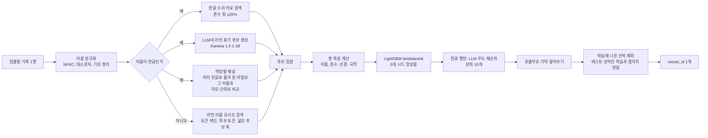

# Port Entity Matching

**항만 입출항 기록 한 줄을 표준 선박 목록(약 7만 8천 척)의 선박 한 척으로 연결하는 개체 매칭 파이프라인**

[](./pyproject.toml) [](./src/port_entity_matching/ranker.py) [](https://dacon.io/competitions/official/236771)

> [!NOTE]
> 해양수산부 주최, 울산항만공사 주관 DACON 대회 프로젝트입니다. 최종 결과는 비공개 리더보드 기준 **0.91989, 468명 중 106위**입니다. 최종 제출물의 공개 리더보드 점수는 0.9595(한글 507/532, 비한글 1738.5/1784 상당)였고, 비공개 점수는 이보다 낮았습니다.
> 대회 데이터는 재배포 금지라 저장소에 없어, 이 저장소만으로는 학습·평가를 재현할 수 없습니다.

## 🧭 개요

항만에는 선박 입출항 기록이 쌓이지만, 기록의 선박명은 오타가 있거나 한글로 적혀 있고 제원이 비어 있는 경우도 많습니다. 이 프로젝트는 기록 한 줄을 받아 표준 선박 목록(`vessel_catalog.csv`)에서 맞는 `vessel_id` 하나를 고릅니다.

| 항목 | 내용 |
| :--- | :--- |
| 입력 | 기록 1행: 선박명, 호출부호, 총톤수, 국제총톤수, 국적, 선종, 입항 연도 |
| 출력 | 표준 목록의 `vessel_id` 1개 (모든 행에 반드시 예측, 보류 없음) |
| 점수 | `0.7 × 한글 선박명 정확도 + 0.3 × 비한글 선박명 정확도` |
| 데이터 | 학습 12,222행, 표준 선박 목록 78,595행 |
| 제약 | 파이썬만 사용, 추론 30분 이내, 제출 ZIP 10GB 이하, 행마다 독립적으로 예측 |

한글 선박명 행은 학습 데이터의 약 9.7%뿐이지만 점수의 70%를 차지합니다(`docs/architecture/data-analysis.md` §1.2). 그래서 한글 이름을 라틴 문자 이름과 맞추는 부분에 가장 많이 공을 들였습니다.

가장 중요한 규칙은 **행 독립성**입니다. 한 행의 예측은 그 행과 표준 목록, 학습 산출물만으로 정해져야 하고, 다른 테스트 행의 분포나 순위를 쓰면 안 됩니다. 같은 행이 혼자 들어가든, 일부만 들어가든, 순서가 섞이든 결과가 같아야 하며, 이를 테스트로 검증합니다.

## 🏗️ 시스템 구성

기록 한 줄이 후보 검색, 특징 계산, 랭커 점수, 재순위를 거쳐 선박 하나로 정해집니다. 모든 단계가 해당 행의 후보 집합 안에서만 계산됩니다.



| 단계 | 하는 일 | 코드 |
| :--- | :--- | :--- |
| 정규화 | 이름을 결정적으로 정리하고 한글 소리 키를 만듦 | [`normalize.py`](./src/port_entity_matching/normalize.py) |
| 후보 검색 | 이름·톤수·희귀 토큰·LLM 표기로 후보를 모음 | [`candidates.py`](./src/port_entity_matching/candidates.py), [`transliterate.py`](./src/port_entity_matching/transliterate.py) |
| 특징 | 기록과 후보 쌍의 유사도·일치 여부를 숫자로 만듦 | [`features.py`](./src/port_entity_matching/features.py) |
| 랭커 | 쌍 점수를 매겨 1위를 고름 | [`ranker.py`](./src/port_entity_matching/ranker.py) |
| 역방향 채널 | 카탈로그 이름을 한글로 미리 옮겨 둔 표기(JSONL)와 한글 기록을 자모 단위로 비교 | [`reverse.py`](./src/port_entity_matching/reverse.py), [`token_renderings.py`](./src/port_entity_matching/token_renderings.py) |
| 재순위 | 한글 행의 상위 후보를 LLM 우도로 보정 | [`rerank.py`](./src/port_entity_matching/rerank.py) |
| 호출부호 기억 | 학습에서 본 호출부호는 해당 선박으로 확정 | [`memory.py`](./src/port_entity_matching/memory.py) |
| 학습 선박 제외 | 호출부호 일치가 없는데 1위가 학습 선박이면 그다음 학습 밖 후보를 고름 | [`pipeline.py`](./src/port_entity_matching/pipeline.py) `_head` |
| 제출 | 추론 진입점과 ZIP 조립 | [`submission/script.py`](./submission/script.py), [`tools/build_submit.py`](./tools/build_submit.py) |

## 🎯 핵심 설계 결정

### 1. 한글 이름을 라틴 이름과 맞추는 방법

**문제.** 한글 이름은 "리플렉션 → Reflection", "흥아 → Heung-A", "에스티아이 → STI"처럼 영어 차용어, 한국어 로마자, 약어 읽기가 섞여 있습니다. 표기 규칙 하나로 맞추기 어렵습니다.

**분석.**

| 대안 | 확인한 내용 | 판단 |
| :--- | :--- | :--- |
| 표준 로마자 표기만 사용 | 소리 분류 키 대신 쓰면 한글 오류 24건에서 63건으로 증가 | 탈락 |
| 한글을 자음·모음 소리 키로 바꿔 비교 | 소리 키를 공유하는 설계만이 신뢰구간이 0을 제외한 유일한 선택이었음 | 채택 |
| 차용어 규칙 추가(키 v2: 묵음 R, 어두 H, 모음 Y) | 한글 오류 23건에서 14건으로 감소 (5개 시드 평균, 교차검증) | 채택 |
| 규칙 대신 LLM이 라틴 표기를 생성 | 공개 리더보드에서 한글 정답이 453건에서 479건까지 오름 | 채택 (아래) |

**선택.** 규칙 기반 소리 키로 후보를 모으고, 여기에 LLM이 만든 라틴 표기 후보를 더합니다. LLM 후보는 검색 단계의 보조 채널일 뿐이고, 최종 판단은 항상 랭커가 합니다.

**결과.** 규칙만 쓴 방식은 교차검증에서는 높았지만 리더보드에서는 크게 떨어졌습니다(아래 3번). LLM 채널을 넣은 제출은 공개 리더보드에서 0.9163을 기록했습니다.

### 2. 랭커: 직접 만든 수식 대신 학습형을 쓴 이유

**문제.** 이름 유사도, 톤수 일치, 선종 궁합 등 신호가 많고 일부는 비어 있습니다. 가중치를 손으로 정하면 결측을 다루기 어렵습니다.

**분석.** 같은 후보와 같은 폴드에서 비교했습니다(`docs/architecture/data-analysis.md` §2.4, 선박 단위 5-fold).

| 방식 | 한글 정확도 | 점수 |
| :--- | :---: | :---: |
| 손으로 정한 가중치 수식 | 0.9740 | 0.9814 |
| 로지스틱 회귀 | 0.9731 | 0.9809 |
| LightGBM binary | 0.9790 | 0.9852 |
| LightGBM lambdarank | 0.9798 | 0.9857 |

**선택.** LightGBM lambdarank를 쓰되, 이 차이가 통계적으로 확실하지는 않다는 점을 문서에 그대로 남겼습니다(신뢰구간이 0을 포함). 장점은 결측을 그대로 두고 신호를 조합할 수 있다는 점입니다. CatBoost 등 다른 모델과의 앙상블은 개선이 없어 채택하지 않았습니다.

### 3. 교차검증 점수와 리더보드 점수의 차이

**문제.** 선박 단위로 나눈 5-fold 교차검증은 0.9875였는데 리더보드는 0.8805였습니다.

**분석.** 원인 후보를 하나씩 측정해 제외했습니다.

| 가설 | 확인 방법 | 결과 |
| :--- | :--- | :--- |
| 학습과 서빙 경로 불일치 | 저장·로드한 모델과 교차검증 예측을 비교 | 차이 0건 |
| 처음 보는 선박 | 학습에 없는 선박의 합성 기록 | 정확도 0.998 |
| 라틴 톤수 잡음 ±10~20% | 스트레스 시나리오 | 0.9965 |
| 라틴 이름 2~4글자 오타 | 합성 기록 | 0.957 |

네 가지 모두 리더보드의 낮은 점수를 설명하지 못했습니다. 그다음 "토큰 순서 바꾸기, 토큰 하나 빼기" 같은 표기 변화를 넣어 보니 정확도가 0.4~0.5 수준으로 무너졌습니다. 학습 데이터에서는 한 선박이 항상 같은 철자를 쓰므로, 교차검증으로는 이런 변화를 볼 수 없었습니다.

**선택.** 깨끗한 교차검증 점수만으로 모델을 고르지 않고, 20개 교란 시나리오를 묶은 스트레스 스위트 점수를 함께 보기로 했습니다. 표기 증강, 순서에 상관없는 검색(정렬 키와 토큰 색인), 순서 불변 특징 7종을 추가했습니다.

**결과.** 로컬 측정 기준입니다.

| 실행 | 깨끗한 점수 (한글 오류) | 스위트 전체 |
| :--- | :---: | :---: |
| v2 기준 | 0.9875 (21) | 0.8162 |
| + 표기 증강 | 0.9875 (21) | 0.8832 |
| + 순서 불변 검색·특징 | 0.9940 (10) | 0.9391 |
| 최종 채택 설정(톤수 창 0.25, 희귀 토큰 확대) | 0.9910 (15) | 0.9477 |

토큰 순서를 바꾼 라틴 이름의 정확도는 0.486에서 0.999로 올랐습니다. 이 수치들은 학습 데이터에서 만든 모의 교란 기준이며, 실제 테스트 데이터의 교란 비율을 보여 주지는 않습니다.

### 4. 점수 차이를 신뢰하기 위한 평가 방식

**문제.** 한글 선박은 382척뿐이라 한 척이 틀리면 한글 정확도가 약 0.25%p 움직입니다. 시드만 바꿔도 한글 오류가 16~19건씩 흔들렸습니다.

**선택.** 선박 단위로 묶어 부트스트랩 95% 신뢰구간을 계산하고, 5개 시드 앙상블로 비교하며, 같은 폴드로 짝지은 비교(`tools/evaluate.py compare`)를 씁니다. "오류 4건 미만의 차이는 한 번의 실행으로 해석하지 않는다"는 기준을 문서에 남기고, 개선이 불확실한 실험(15 leaves, 토큰 정렬 특징, 모델 앙상블 등)은 채택하지 않았습니다.

### 5. 카탈로그 이름을 한글로 미리 옮겨 두는 역방향 채널

**문제.** 한글 기록을 영문으로 옮겨 비교하는 방식은 LLM이 한 번 틀리면 정답이 후보에서 빠집니다. 리더보드에서 확인한 한글 오류 대부분이 이 "읽기" 단계에서 나왔습니다.

**분석.** 방향을 뒤집었습니다. 카탈로그 7.8만 개 이름을 대회 기간 중 공개 LLM으로 미리 한글로 옮겨 파일로 저장해 두고, 기록의 한글 이름을 그 표기와 자모 단위로 직접 비교합니다. 한글끼리 비교하면 읽기 오류가 사라집니다. 리더보드 확인용 제출에서 한글 오류의 41%가 이 비교로 해결됐습니다. 표기 생성의 입력은 공식 카탈로그의 이름뿐이고 공개 사전학습 가중치만 썼습니다(규칙이 허용하는 범위). 다만 이 방식을 직접 물은 대회 게시글에는 운영진 답변이 없었으므로, 생성 코드·프롬프트·디코딩 설정을 검증 요청에 대비해 보관했습니다.

**결과.** 한글 정답이 491개에서 505개로, 점수가 0.9340에서 0.9525로 올랐습니다. 이 프로젝트에서 한 번에 가장 크게 오른 개선입니다. 카탈로그 이름 하나에 표기를 여러 개 두고(변형 합집합), 학습 데이터의 토큰 대응표와 알파벳 약어 읽기 규칙으로 만든 표기를 더하는 방식으로 확장했습니다(`token_renderings.py`).

### 6. 테스트 선박은 학습 선박과 겹치지 않는다

**확인.** 학습 데이터의 선박만 찾아 주는 제출을 만들어 리더보드로 점수를 읽었습니다. 맞은 개수가 0이어서 테스트 선박과 학습 선박이 겹치지 않는다는 것을 확인했습니다.

**활용.** 호출부호 일치가 없는데 1위 후보가 학습에 나온 선박이면 그 답은 이번 평가에서 반드시 틀립니다. 그래서 그다음 학습 밖 후보로 바꿨고, 한글 +1, 비한글 +6행이 올랐습니다. 이 규칙은 대회 분할 구조를 이용한 것이어서, 현장에서는 이미 본 선박이 다시 나오므로 호출부호 기억이 그 역할을 합니다.

### 7. 더 이상 점수가 오르지 않은 방향

아래는 모두 공개 리더보드에서 실제로 확인한 결과입니다. 한글 정답 수 변화는 현재 최고 기준(507)입니다.

| 시도 | 한글 변화 | 해석 |
| :--- | :---: | :--- |
| 더 큰 LLM(Kanana-8B, A.X-4.0-Light)으로 카탈로그 표기를 다시 생성 | 0, −1 | 표기 정확도는 62%에서 77%까지 올랐지만 점수는 그대로 |
| 표준 외래어 표기법 방식의 표기, 숫자 표기 변형(일·이, 원·투, II) | 0 | 시뮬레이션에서는 취약했으나 테스트에 해당 변형이 없음 |
| 8B 모델을 직접 학습한 판독기, 한자 읽기 키 | 0 | 판독기 크기는 병목이 아님 |
| CatBoost pairlogit 랭커 | −3 | 랭커 종류는 병목이 아님 |
| 약칭·순서 바뀐 이름 규칙 | 구제 1개 | 행 하나만으로는 구분할 수 없는 경우가 대부분 |
| 학습 선박 분포로 만든 선박 사전확률(선종·크기·국적 등) | −4 (비한글 −13행) | 테스트 정답은 학습 선박과 같은 분포가 아님 |
| LLM 검색 빔 2개→5개, 재순위 10개→20개 | 0 | 후보 범위는 병목이 아님 |

**결론.** 남은 한글 오류 25개는 후보를 못 찾아서가 아니라, 이름이 거의 같은 자매선 중 어느 배인지 한 행만으로 정할 수 없어서 생깁니다. 학습 데이터에서는 같은 호출부호의 다른 기록들을 모아 투표하면 이 오류가 100개에서 6개로 줄지만, 대회 규칙이 다른 행을 이용한 그룹 투표를 금지하므로 쓰지 않았습니다.

## ✅ 결과

| 기준 | 지표 | 값 | 근거 |
| :--- | :--- | :---: | :--- |
| 로컬 5-fold(선박 단위) | 가중 점수, 최종 채택 설정 | 0.9910 | `docs/architecture/data-analysis.md` §2.7 |
| 로컬 5-fold(선박 단위) | 스트레스 스위트 점수 | 0.9477 | 같은 문서 §2.7 |
| 공개 리더보드 최종 제출물 | 점수 / 한글 정답 / 비한글 정답 | 0.9595 / 507 of 532 / 1738.5 of 1784 | 같은 문서 §3.2 |
| 비공개 리더보드 최종 | 점수 / 순위 | 0.91989 / 106위 (468명) | DACON 최종 리더보드 |
| 로컬 8,200행 리허설 | 추론 시간, 최대 메모리 | 470초, 5.1GB | RTX 4070 Ti, LLM 포함. 서버(L4)는 약 2배로 추정해 16분 |

**공개 리더보드 점수 이력**

| 날짜 | 변경 | 점수 | 한글 | 비한글 |
| :--- | :--- | :---: | :---: | :---: |
| 10-22 | 규칙 기반 v2 | 0.8805 | | |
| 10-24 | LLM 라틴 표기 후보 채널 | 0.9163 | 479 | 1701 |
| 10-25 | 역번역 LoRA로 LLM 미세조정 | 0.9330 | 492 | 1698.5 |
| 10-27 | **역방향 채널**(카탈로그 한글 표기) | 0.9525 | 505 | 1713 |
| 10-30 | 라틴 후보 폭 확대 | 0.9563 | 505 | 1735.5 |
| 10-31 | 학습 선박 제외 | 0.9581 | 506 | 1738.5 |
| 10-31 | + 학습 토큰 대응표와 약어 읽기 | **0.9595** | **507** | **1738.5** |

- 공개 리더보드는 테스트의 50%로 계산한 점수이며, 최종 순위는 대회 종료 후 비공개 리더보드(100% 기준)로 정해졌습니다. 공개 0.9595에서 비공개 0.91989로 약 0.04 낮아졌고, 원인은 분석하지 않았습니다.
- 10월 14일에 운영진이 "다양한 사례"를 평가 데이터에 추가했고(기존 3,000행 유지, 학습 데이터·점수식 불변), 리더보드는 10월 19일에 초기화됐습니다. 표의 점수는 모두 초기화 이후 값이며, 평가 데이터는 합계 약 8,200행으로 추정합니다(공개 점수 복원에서 한글 532 + 비한글 3,568행이 나오고 공개는 전체의 50%).
- 위 로컬 점수(0.9910)는 LLM 채널을 넣기 전 번들의 값입니다. LLM 채널을 포함한 현재 코드의 깨끗한 교차검증 점수는 측정하지 않았습니다.
- 한글 이름 LLM 비교에서 표기 증강을 넣은 변형(E1)은 리더보드 0.9036으로 오히려 낮아 되돌렸습니다.

## ⚠️ 한계

- 교차검증과 리더보드의 차이는 끝까지 완전히 설명하지 못했습니다. 로컬에서 만든 모의 오류(철자, 톤수, 약칭, 숫자 표기)는 대부분 흡수했지만 리더보드 한글 오류의 원인은 모의 오류로 재현되지 않았습니다.
- 토큰 하나가 빠진 이름은 약합니다. 라틴 이름은 정확도 약 0.69, 한글 이름은 약 0.65입니다(모의 교란 기준). 같은 토큰을 가진 자매선이 많아 한 행으로는 구분할 수 없는 경우가 많습니다.
- 한글 행에서 LLM 생성은 이름당 약 0.24초(RTX 4070 Ti)가 걸립니다. 서버에서는 따로 재야 하며, 추론 시간은 순위 동점 시 판정 기준이 됩니다.
- 공개 리더보드 위쪽에는 한글 오류율이 비한글보다 낮은 팀이 많습니다. 행 단위 예측만으로는 설명하기 어려운 패턴이지만 원인은 확인하지 못했고, 다른 팀이 규칙을 어겼다고 단정할 근거도 없습니다.
- 일부 평가 도구는 학습 데이터가 있어야 돌아가며, 데이터가 저장소에 없어 바로 재현할 수 없습니다.

## 🛠️ 기술 스택

| 구분 | 사용 기술 |
| :--- | :--- |
| 언어 | Python 3.11 |
| 매칭·랭킹 | LightGBM 4.6.0, scikit-learn 1.5.2, RapidFuzz 3.14.3, pandas 2.0.3, numpy 1.26.4 |
| LLM(후보 생성·재순위) | Kanana 1.5 2.1B Instruct(역번역 LoRA 미세조정), PyTorch 2.7.1, Transformers 4.57.6 |
| 카탈로그 한글 표기 생성(오프라인) | Midm-2.0-Mini 2.3B, Kanana 1.5 2.1B. 결과 JSONL만 제출물에 포함 |
| 개발 도구 | uv, pytest, Hypothesis, ruff, mypy |

버전은 대회 평가 서버에 미리 설치된 환경에 맞춰 고정했습니다([`pyproject.toml`](./pyproject.toml)).

## 📂 프로젝트 구조

```text
port-entity-matching/
├── src/port_entity_matching/
│   ├── normalize.py          # 이름 정규화, 한글 소리 키
│   ├── transliterate.py      # LLM 라틴 표기 생성·우도 점수
│   ├── candidates.py         # 후보 검색
│   ├── reverse.py            # 역방향 채널(미리 옮긴 한글 표기와 자모 비교)
│   ├── token_renderings.py   # 학습 토큰 대응표·약어 읽기로 만든 표기 (제출물 제외)
│   ├── features.py           # 쌍 특징
│   ├── augment.py            # 학습용 열화·표기 증강
│   ├── ranker.py, train.py   # 랭커, 교차검증·학습
│   ├── rerank.py, memory.py  # LLM 재순위, 호출부호 기억
│   ├── pipeline.py           # 행 독립 추론
│   └── evaluation/           # 스트레스·트윈 평가, 통계 (제출물 제외)
├── submission/script.py      # 대회 제출 진입점
├── tools/                    # evaluate.py, build_submit.py, derive_model.py, build_probe.py, lb.py, verify.py
├── tests/                    # 단위·통합 테스트(행 독립성, 제출 형식)
└── docs/architecture/        # 대회 규칙, 데이터 분석과 실험 기록
```

## 🚀 시작하기

대회 데이터를 직접 내려받아 `data/`에 넣어야 하며(저장소에는 없음), LLM 가중치도 저장소에 없습니다. 제출 ZIP을 조립하려면 `--llm-dir`로 가중치 폴더를 지정합니다. 개발 중 쓴 모델 목록은 위 기술 스택 표를 참고하세요.

```bash
uv sync                                            # 의존성 설치
uv run pytest                                      # 테스트
uv run python tools/verify.py                      # 품질 검사
uv run python tools/evaluate.py cv --out-dir artifacts/eval/run1      # 선박 단위 교차검증
uv run python tools/evaluate.py stress --out-dir artifacts/eval/run1  # 교란 스트레스 테스트
uv run python tools/build_submit.py --model-dir artifacts/model_final --llm-dir <LLM 폴더> --out artifacts/submit.zip   # 제출 ZIP 조립
uv run python tools/derive_model.py --from <기존 모델> --to <새 모델> --add-reverse <표기.jsonl>              # 재학습 없이 표기 파일 추가
```

## 🤖 개발 과정에서의 AI 활용

주로 AI에게 맡긴 일은 코드 작성이고, 아이디어 정리와 도메인 개념 학습에도 도움을 받았습니다. 결과 수치와 동작은 AI의 설명에 의존하지 않고 직접 확인했습니다.

## 📚 참고

- 대회: [DACON 항만 문제 해결 AI 기술 경진대회](https://dacon.io/competitions/official/236771)
- 대회 규칙·제출 형식: [`docs/architecture/competition.md`](./docs/architecture/competition.md)
- 데이터 분석과 전체 실험 기록: [`docs/architecture/data-analysis.md`](./docs/architecture/data-analysis.md)
