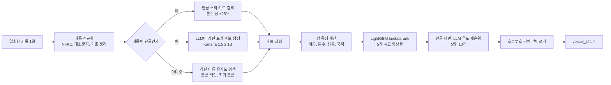

# Port Entity Matching

**항만 입출항 기록 한 줄을 표준 선박 목록(약 7만 8천 척)의 선박 한 척으로 연결하는 개체 매칭 파이프라인**

[](./pyproject.toml) [](./src/port_entity_matching/ranker.py) [](https://dacon.io/competitions/official/236771)

> [!NOTE]
> 해양수산부 주최, 울산항만공사 주관 DACON 대회 프로젝트입니다. 대회가 2026-11-02에 종료되므로 최종 순위는 적지 않았고, **로컬 교차검증과 공개 리더보드 점수**만 기록했습니다.
> 대회 데이터는 재배포 금지라 저장소에 없어, 이 저장소만으로는 학습·평가를 재현할 수 없습니다.

## 🧭 개요

항만에는 선박 입출항 기록이 쌓이지만, 기록의 선박명은 오타가 있거나 한글로 적혀 있고 제원이 비어 있는 경우도 많습니다. 이 프로젝트는 기록 한 줄을 받아 표준 선박 목록(`vessel_catalog.csv`)에서 맞는 `vessel_id` 하나를 고릅니다.

| 항목 | 내용 |
| :--- | :--- |
| 입력 | 기록 1행: 선박명, 호출부호, 총톤수, 국제총톤수, 국적, 선종, 입항 연도 |
| 출력 | 표준 목록의 `vessel_id` 1개 (모든 행에 반드시 예측, 보류 없음) |
| 점수 | `0.7 × 한글 선박명 정확도 + 0.3 × 비한글 선박명 정확도` |
| 데이터 | 학습 12,222행, 표준 선박 목록 78,595행 |
| 제약 | 파이썬만 사용, 추론 30분 이내, 제출 ZIP 10GB 이하, 행마다 독립적으로 예측 |

한글 선박명 행은 학습 데이터의 약 9.7%뿐이지만 점수의 70%를 차지합니다(`docs/architecture/data-analysis.md` §1.2). 그래서 한글 이름을 라틴 문자 이름과 맞추는 부분에 가장 많이 공을 들였습니다.

가장 중요한 규칙은 **행 독립성**입니다. 한 행의 예측은 그 행과 표준 목록, 학습 산출물만으로 정해져야 하고, 다른 테스트 행의 분포나 순위를 쓰면 안 됩니다. 같은 행이 혼자 들어가든, 일부만 들어가든, 순서가 섞이든 결과가 같아야 하며, 이를 테스트로 검증합니다.

## 🏗️ 시스템 구성

기록 한 줄이 후보 검색, 특징 계산, 랭커 점수, 재순위를 거쳐 선박 하나로 정해집니다. 모든 단계가 해당 행의 후보 집합 안에서만 계산됩니다.



| 단계 | 하는 일 | 코드 |
| :--- | :--- | :--- |
| 정규화 | 이름을 결정적으로 정리하고 한글 소리 키를 만듦 | [`normalize.py`](./src/port_entity_matching/normalize.py) |
| 후보 검색 | 이름·톤수·희귀 토큰·LLM 표기로 후보를 모음 | [`candidates.py`](./src/port_entity_matching/candidates.py), [`transliterate.py`](./src/port_entity_matching/transliterate.py) |
| 특징 | 기록과 후보 쌍의 유사도·일치 여부를 숫자로 만듦 | [`features.py`](./src/port_entity_matching/features.py) |
| 랭커 | 쌍 점수를 매겨 1위를 고름 | [`ranker.py`](./src/port_entity_matching/ranker.py) |
| 재순위 | 한글 행의 상위 후보를 LLM 우도로 보정 | [`rerank.py`](./src/port_entity_matching/rerank.py) |
| 호출부호 기억 | 학습에서 본 호출부호는 해당 선박으로 확정 | [`memory.py`](./src/port_entity_matching/memory.py) |
| 제출 | 추론 진입점과 ZIP 조립 | [`submission/script.py`](./submission/script.py), [`tools/build_submit.py`](./tools/build_submit.py) |

## 🎯 핵심 설계 결정

### 1. 한글 이름을 라틴 이름과 맞추는 방법

**문제.** 한글 이름은 "리플렉션 → Reflection", "흥아 → Heung-A", "에스티아이 → STI"처럼 영어 차용어, 한국어 로마자, 약어 읽기가 섞여 있습니다. 표기 규칙 하나로 맞추기 어렵습니다.

**분석.**

| 대안 | 확인한 내용 | 판단 |
| :--- | :--- | :--- |
| 표준 로마자 표기만 사용 | 소리 분류 키 대신 쓰면 한글 오류 24건에서 63건으로 증가 | 탈락 |
| 한글을 자음·모음 소리 키로 바꿔 비교 | 소리 키를 공유하는 설계만이 신뢰구간이 0을 제외한 유일한 선택이었음 | 채택 |
| 차용어 규칙 추가(키 v2: 묵음 R, 어두 H, 모음 Y) | 한글 오류 23건에서 14건으로 감소 (5개 시드 평균, 교차검증) | 채택 |
| 규칙 대신 LLM이 라틴 표기를 생성 | 공개 리더보드에서 한글 정답이 453건에서 479건까지 오름 | 채택 (아래) |

**선택.** 규칙 기반 소리 키로 후보를 모으고, 여기에 LLM이 만든 라틴 표기 후보를 더합니다. LLM 후보는 검색 단계의 보조 채널일 뿐이고, 최종 판단은 항상 랭커가 합니다.

**결과.** 규칙만 쓴 방식은 교차검증에서는 높았지만 리더보드에서는 크게 떨어졌습니다(아래 3번). LLM 채널을 넣은 제출은 공개 리더보드에서 0.9163을 기록했습니다.

### 2. 랭커: 직접 만든 수식 대신 학습형을 쓴 이유

**문제.** 이름 유사도, 톤수 일치, 선종 궁합 등 신호가 많고 일부는 비어 있습니다. 가중치를 손으로 정하면 결측을 다루기 어렵습니다.

**분석.** 같은 후보와 같은 폴드에서 비교했습니다(`docs/architecture/data-analysis.md` §2.4, 선박 단위 5-fold).

| 방식 | 한글 정확도 | 점수 |
| :--- | :---: | :---: |
| 손으로 정한 가중치 수식 | 0.9740 | 0.9814 |
| 로지스틱 회귀 | 0.9731 | 0.9809 |
| LightGBM binary | 0.9790 | 0.9852 |
| LightGBM lambdarank | 0.9798 | 0.9857 |

**선택.** LightGBM lambdarank를 쓰되, 이 차이가 통계적으로 확실하지는 않다는 점을 문서에 그대로 남겼습니다(신뢰구간이 0을 포함). 장점은 결측을 그대로 두고 신호를 조합할 수 있다는 점입니다. CatBoost 등 다른 모델과의 앙상블은 개선이 없어 채택하지 않았습니다.

### 3. 교차검증 점수와 리더보드 점수의 차이

**문제.** 선박 단위로 나눈 5-fold 교차검증은 0.9875였는데 리더보드는 0.8805였습니다.

**분석.** 원인 후보를 하나씩 측정해 제외했습니다.

| 가설 | 확인 방법 | 결과 |
| :--- | :--- | :--- |
| 학습과 서빙 경로 불일치 | 저장·로드한 모델과 교차검증 예측을 비교 | 차이 0건 |
| 처음 보는 선박 | 학습에 없는 선박의 합성 기록 | 정확도 0.998 |
| 라틴 톤수 잡음 ±10~20% | 스트레스 시나리오 | 0.9965 |
| 라틴 이름 2~4글자 오타 | 합성 기록 | 0.957 |

네 가지 모두 리더보드의 낮은 점수를 설명하지 못했습니다. 그다음 "토큰 순서 바꾸기, 토큰 하나 빼기" 같은 표기 변화를 넣어 보니 정확도가 0.4~0.5 수준으로 무너졌습니다. 학습 데이터에서는 한 선박이 항상 같은 철자를 쓰므로, 교차검증으로는 이런 변화를 볼 수 없었습니다.

**선택.** 깨끗한 교차검증 점수만으로 모델을 고르지 않고, 20개 교란 시나리오를 묶은 스트레스 스위트 점수를 함께 보기로 했습니다. 표기 증강, 순서에 상관없는 검색(정렬 키와 토큰 색인), 순서 불변 특징 7종을 추가했습니다.

**결과.** 로컬 측정 기준입니다.

| 실행 | 깨끗한 점수 (한글 오류) | 스위트 전체 |
| :--- | :---: | :---: |
| v2 기준 | 0.9875 (21) | 0.8162 |
| + 표기 증강 | 0.9875 (21) | 0.8832 |
| + 순서 불변 검색·특징 | 0.9940 (10) | 0.9391 |
| 최종 채택 설정(톤수 창 0.25, 희귀 토큰 확대) | 0.9910 (15) | 0.9477 |

토큰 순서를 바꾼 라틴 이름의 정확도는 0.486에서 0.999로 올랐습니다. 이 수치들은 학습 데이터에서 만든 모의 교란 기준이며, 실제 테스트 데이터의 교란 비율을 보여 주지는 않습니다.

### 4. 점수 차이를 신뢰하기 위한 평가 방식

**문제.** 한글 선박은 382척뿐이라 한 척이 틀리면 한글 정확도가 약 0.25%p 움직입니다. 시드만 바꿔도 한글 오류가 16~19건씩 흔들렸습니다.

**선택.** 선박 단위로 묶어 부트스트랩 95% 신뢰구간을 계산하고, 5개 시드 앙상블로 비교하며, 같은 폴드로 짝지은 비교(`tools/evaluate.py compare`)를 씁니다. "오류 4건 미만의 차이는 한 번의 실행으로 해석하지 않는다"는 기준을 문서에 남기고, 개선이 불확실한 실험(15 leaves, 토큰 정렬 특징, 모델 앙상블 등)은 채택하지 않았습니다.

## ✅ 결과

| 기준 | 지표 | 값 | 근거 |
| :--- | :--- | :---: | :--- |
| 로컬 5-fold(선박 단위) | 가중 점수, 최종 채택 설정 | 0.9910 | `docs/architecture/data-analysis.md` §2.7 |
| 로컬 5-fold(선박 단위) | 스트레스 스위트 점수 | 0.9477 | 같은 문서 §2.7 |
| 공개 리더보드(2026-10-22) | 규칙 기반 v2 | 0.8805 | 같은 문서 §2.7 |
| 공개 리더보드 | LLM 후보 채널 제출 | 0.9163 | 같은 문서 §2.8 |
| 공개 리더보드 | 위 제출의 한글 / 비한글 정답 수 | 479/532, 1701/1784 | 같은 문서 §2.8 |
| 로컬 3,000행 리허설 | 추론 시간, 최대 메모리 | 15.2초, 388MB | 같은 문서 §2.7 (LLM 미포함 번들) |

- 공개 리더보드는 테스트의 50%로 계산한 점수이며, 최종 순위는 대회 종료 후 비공개 리더보드가 정합니다.
- 위 로컬 점수(0.9910)는 LLM 채널을 넣기 전 번들의 값입니다. LLM 채널을 포함한 현재 코드의 깨끗한 교차검증 점수는 아직 측정하지 않았습니다.
- LLM 포함 서빙 시간은 RTX 4070 Ti 리허설(4,632행, 179.9초)로 확인했고, 서버(L4) 실측은 아닙니다.
- 한글 이름 LLM 비교에서 표기 증강을 넣은 변형(E1)은 리더보드 0.9036으로 오히려 낮아 되돌렸습니다.

## ⚠️ 한계

- 리더보드와 교차검증의 차이가 줄었는지는 비공개 리더보드가 나와야 알 수 있습니다. 로컬 점수는 대회 종료 전 시점의 기록입니다.
- 토큰 하나가 빠진 이름은 아직 약합니다. 라틴 이름은 정확도 약 0.69, 한글 이름은 약 0.65입니다(모의 교란 기준).
- 한글 행에서 LLM 생성은 이름당 약 0.24초(RTX 4070 Ti)가 걸립니다. 서버에서는 따로 재야 하며, 추론 시간은 순위 동점 시 판정 기준이 됩니다.
- 일부 오류는 이름과 톤수가 같은 자매선 사이에서 생기며, 대회 규정상 외부 선박 DB를 쓸 수 없어 구분이 어렵습니다.
- 일부 평가 도구는 학습 데이터가 있어야 돌아가며, 데이터가 저장소에 없어 바로 재현할 수 없습니다.

## 🛠️ 기술 스택

| 구분 | 사용 기술 |
| :--- | :--- |
| 언어 | Python 3.11 |
| 매칭·랭킹 | LightGBM 4.6.0, scikit-learn 1.5.2, RapidFuzz 3.14.3, pandas 2.0.3, numpy 1.26.4 |
| LLM(후보 생성·재순위) | Kanana 1.5 2.1B Instruct (기본값), PyTorch 2.7.1, Transformers 4.57.6 |
| 개발 도구 | uv, pytest, Hypothesis, ruff, mypy |

버전은 대회 평가 서버에 미리 설치된 환경에 맞춰 고정했습니다([`pyproject.toml`](./pyproject.toml)).

## 📂 프로젝트 구조

```text
port-entity-matching/
├── src/port_entity_matching/
│   ├── normalize.py          # 이름 정규화, 한글 소리 키
│   ├── transliterate.py      # LLM 라틴 표기 생성·우도 점수
│   ├── candidates.py         # 후보 검색
│   ├── features.py           # 쌍 특징
│   ├── augment.py            # 학습용 열화·표기 증강
│   ├── ranker.py, train.py   # 랭커, 교차검증·학습
│   ├── rerank.py, memory.py  # LLM 재순위, 호출부호 기억
│   ├── pipeline.py           # 행 독립 추론
│   └── evaluation/           # 스트레스·트윈 평가, 통계 (제출물 제외)
├── submission/script.py      # 대회 제출 진입점
├── tools/                    # evaluate.py, build_submit.py, verify.py
├── tests/                    # 단위·통합 테스트(행 독립성, 제출 형식)
└── docs/architecture/        # 대회 규칙, 데이터 분석과 실험 기록
```

## 🚀 시작하기

대회 데이터를 직접 내려받아 `data/`에 넣어야 하며(저장소에는 없음), 평가용 LLM 가중치는 `artifacts/hf/` 아래에 두는 구성을 기본으로 합니다.

```bash
uv sync                                            # 의존성 설치
uv run pytest                                      # 테스트
uv run python tools/verify.py                      # 품질 검사
uv run python tools/evaluate.py cv --out-dir artifacts/eval/run1      # 선박 단위 교차검증
uv run python tools/evaluate.py stress --out-dir artifacts/eval/run1  # 교란 스트레스 테스트
uv run python tools/build_submit.py                # 제출 ZIP 조립
```

## 🤖 개발 과정에서의 AI 활용

주로 AI에게 맡긴 일은 코드 작성이고, 아이디어 정리와 도메인 개념 학습에도 도움을 받았습니다. 결과 수치와 동작은 AI의 설명에 의존하지 않고 직접 확인했습니다.

## 📚 참고

- 대회: [DACON 항만 문제 해결 AI 기술 경진대회](https://dacon.io/competitions/official/236771)
- 대회 규칙·제출 형식: [`docs/architecture/competition.md`](./docs/architecture/competition.md)
- 데이터 분석과 전체 실험 기록: [`docs/architecture/data-analysis.md`](./docs/architecture/data-analysis.md)
